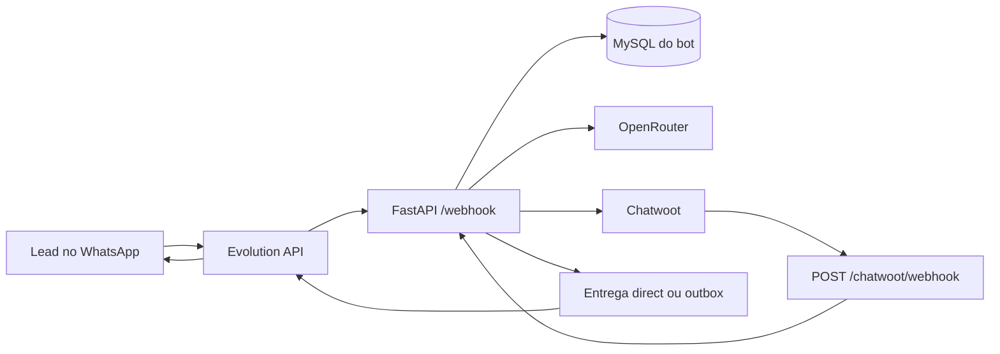

# WPP AI Bot

Plataforma open source e self-hosted de atendimento por texto no WhatsApp com IA generativa, histórico por agente, medição de consumo LLM e transferência para atendimento humano no Chatwoot.

Licenciada sob [Apache-2.0](LICENSE): uso, modificação, redistribuição e uso comercial são permitidos, conforme os termos da licença.

## Objetivo e definição

Automatizar o primeiro atendimento de contatos no WhatsApp no contexto de cada agente/negócio configurado, responder com prompt/modelo autorizados e entregar ao atendente humano o contexto necessário quando houver transferência.

1. **Atendimento:** receber mensagens pela Evolution API, preservar contexto e responder via OpenRouter.
2. **Operação humana:** abrir conversa no Chatwoot e encaminhar respostas do atendente ao lead.
3. **Controle:** registrar uso/custo, aplicar soft limit e oferecer mecanismos auditáveis de entrega, recuperação e operação.

### Modelo implementado e direção do projeto

| Hoje, no código | Direção planejada, ainda não implementada |
| --- | --- |
| Uma instalação self-hosted; múltiplos números/agentes com configuração e histórico isolados | Suporte a múltiplos espaços de trabalho na mesma instalação, com isolamento de acesso |
| Operador configura agentes, prompts, modelos e limites por API/CLI, com login, papéis fixos (`admin`/`operador`/`leitura`), TOTP obrigatório para admin e auditoria | Painel e papéis por espaço de trabalho |
| Chatwoot gerencia atendimento humano | Configurações e credenciais por espaço de trabalho no futuro painel |

Ainda não é um serviço pronto para várias empresas. Usuários, papéis fixos e auditoria existem para uma única empresa por instalação, só na API (sem tela). Multiagente não significa que empresas distintas já possam compartilhar com segurança uma instalação: não existe `empresa_id` no schema atual.

## Estado do projeto

**Snapshot documental: 2026-11-09, base `main` = `dev` = `5908a94`.** F0 integrado via PR #14; main promovida por fast-forward; certificação integrada p55 aceita. Esta edição não atesta deploy nem a ativação de features.

| Frente | Estado |
| --- | --- |
| OpenRouter, allowlist, modelos por agente, consumo e soft limit | Implementados |
| Handoff e retorno Chatwoot | Implementados; ativação operacional do release pendente |
| Outbox fenced, retry e CLIs de cutover/rollback | Implementados; `direct` e dispatch desligado são os defaults |
| Scheduler de inbox, geração fora de locks, typing e opt-in | Implementados, desligados por default; ativação exige gates próprios |
| Retenção, compatibilidade de réplicas e shutdown com prazo | Implementados até PR #13 |
| Imagens imutáveis, pins adicionais, preflight e bloqueio público do CRUD | F0 integrado/certificado em `5908a94`; deploy/ativação continuam separados |
| Preparação/persistência Chatwoot, prazo total de readiness e procedimento de release | Hardening complementar planejado |
| Login da API: sessão, tokens de serviço, RBAC fixo, TOTP admin, auditoria | Implementado (empresa única, só API); Nginx não expõe `/auth` |
| Painel/portal multi-empresa | Planejamento separado |
| E2E do release com WhatsApp pareado e LLM real | Pendente de autorização/setup operacional |

Merge não significa feature ativada, stack implantada ou E2E concluído. [Estado e roadmap](docs/mapa-do-projeto/estado-e-roadmap.md).

## Stack atual

| Área | Tecnologia declarada |
| --- | --- |
| Aplicação | Python 3.12, FastAPI 0.109.0, Uvicorn 0.27.0 |
| Configuração | Pydantic 2.5.3, pydantic-settings 2.1.0 |
| Dados do bot | MySQL 8.0, SQLAlchemy async 2.0.52, aiomysql 0.2.0 |
| LLM | OpenRouter via SDK `openai` 1.54.0 e `AsyncOpenAI` |
| HTTP/logging | httpx 0.26.0, Loguru 0.7.2; requests em caminhos auxiliares |
| WhatsApp | Evolution API v2.3.7, Postgres e Redis próprios |
| Atendimento humano | Chatwoot v4.17.1, Sidekiq, `pgvector/pgvector:pg15` e Redis 7 |
| Containers/borda | Docker Engine, Compose e Nginx |
| Painel Evolution | Imagem `evoapicloud/evolution-manager`, não frontend próprio do repo |

Versões vêm de `app/requirements.in`, `app/requirements.lock`, `app/Dockerfile` e `docker-compose.yml`, não de containers inspecionados. **17 serviços declarados**, incluindo profiles de CLI e migration one-shot. [Serviços, imagens e volumes](docs/mapa-do-projeto/operacao-e-validacao.md).

## Fluxo de atendimento



Diagrama de integrações, não de uma única transação:

- **Direct não agendado:** geração e envio antes do commit; legado sem retry durável equivalente ao outbox.
- **Outbox não agendado:** entrega pelo worker após commit; LLM/resumo ainda ocorre dentro da UoW do webhook.
- **Scheduler habilitado para o agente:** intake curto → attempt durável → geração fora de locks → admissão outbox → entrega fenced.

**Outbox não ativa scheduler nem elimina sozinho a janela de consumo perdido no legado.** [Arquitetura e fluxos](docs/mapa-do-projeto/arquitetura.md).

## Segurança e limites conhecidos

- CRUD `/agentes` e `/sessoes` exige login no app (401 sem credencial, 403 sem permissão, 503 sem chaves `AUTH_*`) e continua bloqueado pelo Nginx. `/auth/*` também é interno; expor qualquer dessas rotas é decisão separada. Não publicar `app:5000` nem criar proxy alternativo.
- Rate limit de login por origem é em memória por processo; o controle durável é o bloqueio por conta. Acesso ao container (CLIs) continua privilegiado e fora do login.
- `PROVIDER_WEBHOOK_AUTH_MODE=provisioning` é bootstrap, não modo público seguro. Ingress fechado até contratos verificados e auth `enforced`.
- App não publica porta `5000` no host. Diagnóstico interno não é API pública.
- Crash/rollback pós-LLM pode perder ledger no fluxo não agendado, inclusive outbox; plano pós-F0 aprovado prevê scheduler antes de tráfego comercial, ainda sem ativação.
- Readiness tem corpo mínimo público, mas deadline completo ainda é pendência; liveness não é readiness.
- Evolution tem entrega bounded at-least-once: ACK perdido pode produzir duplicata, sem promessa de exactly-once remoto.
- Soft limit não é reserva estrita de orçamento; medição não implementa cobrança automática.

Plano pós-F0 aprovado em 2026-11-07, **planejado e não implementado**: Onda 0 documentação → T6/T7 + T8 → T9 + allowlist P3 → T10 → F1–F8 com F6b scheduler. D10 prevê scheduler antes de tráfego comercial; F6 exige outbox para lead real; D9 prevê storage/AOF Chatwoot e D11 deadline único de readiness. Defaults permanecem inalterados. [Decisões e gates](docs/mapa-do-projeto/estado-e-roadmap.md).

## Navegação

| Caminho | Conteúdo |
| --- | --- |
| [AGENTS.md](AGENTS.md) | Instruções e contratos obrigatórios para agentes |
| [Mapa do projeto](docs/mapa-do-projeto/README.md) | Arquitetura, código, dados, operação e roadmap |
| [app/src/](app/src/) | API, serviços, workers, CLIs e dados |
| [app/tests/](app/tests/) | Testes unitários, contratos e integração MySQL |
| [db/init.sql](db/init.sql) | Schema/migrations, checks, FKs e triggers |
| [scripts/](scripts/) | Matrizes, mutações, preflight e provisionamento |
| [docker-compose.dev.yml](docker-compose.dev.yml) | Override dev explícito de código, separado do release |
| [nginx/](nginx/) / [chatwoot/](chatwoot/) | Borda HTTP e proteção de logs |
| [tests/provider_contracts/](tests/provider_contracts/) | Provas auxiliares dos providers |

## Preparação e operação

Desenvolvimento exige Git, Docker Engine, Docker Compose v2 (`docker compose version`), Docker Buildx (`docker buildx version`) e Python 3.12 quando executar tooling fora da imagem. Buildx ausente em host Debian/Ubuntu: `sudo apt-get install -y docker-buildx-plugin`. Dependências: [requirements.in](app/requirements.in) declara diretas; [requirements.lock](app/requirements.lock) fixa transitivas/hashes; [requirements.txt](app/requirements.txt) é alias. Docker instala somente wheels com hashes, sem fallback para sdist.

Release usa código da imagem e pins de infraestrutura por digest. Seis serviços Python compartilham `${COMPOSE_PROJECT_NAME:?}-app:${DELIVERY_WORKER_CODE_VERSION:?}`; somente `app` declara build. ARG, arquivo baked, label e env precisam coincidir; mismatch recusa startup. Bind de código só no override dev explícito e não atesta código release. `COMPOSE_PROJECT_NAME` obrigatório, rede/volumes por projeto e Nginx com bind default `127.0.0.1`.

Templates: [.env.example](.env.example) e [app/.env.example](app/.env.example). Contêm placeholders públicos: não são configuração pronta nem devem substituir `.env` existente. `OPENROUTER_API_KEY` é segredo runtime; não confundir com ferramentas de desenvolvimento ou OpenAI nativa da Evolution.

## Desenvolvimento local (HTTP-only, não certificado)

Defina projeto descartável próprio, versão de teste e `NGINX_CONF_PATH=./nginx/nginx.dev.conf`
no `.env` local. Use bind de código somente pelo override explícito:

```bash
docker compose -f docker-compose.yml -f docker-compose.dev.yml build app
docker compose -f docker-compose.yml -f docker-compose.dev.yml up -d --no-build
```

Esse caminho não gera recibo de release; código montado pode diferir da versão baked.
Não usar projeto/volumes compartilhados para testes.

## Release certificado (HTTP local ou SSL)

Pré-condições: checkout limpo no commit aprovado, gates de revisão/testes aprovados,
projeto escolhido explicitamente (não placeholder), segredos reais fora do Git e
`DELIVERY_WORKER_CODE_VERSION` no candidato igual a `git rev-parse --short HEAD`.
`COMPOSE_PROJECT_NAME` explícito no shell deve coincidir com o candidato. Não source/eval
`.env`. Nenhum override automático/COMPOSE_FILE/COMPOSE_PROFILES; profiles extras só
por `--profile` explícito, após gates correspondentes. `-p` não substitui preflight.

HTTP local: candidato com Nginx dev, bind127.0.0.1 e portas escolhidas explicitamente.
SSL/VPS: `nginx/nginx.conf` exige `nginx/certs/fullchain.pem` e
`nginx/certs/privkey.pem`; bind público só explícito, ingress/auth previamente validados.
Provisioning continua loopback; não assumir que builder/preflight executam setup
operacional, cutover ou gates futuros. SMTP é tudo-ou-nada; VPS pode exigir
`--require-smtp`. Não habilitar dispatch/scheduler/processor para subir a stack.

Após preparar `.env` operacional revisado (o mesmo candidato usado no deploy):

```bash
scripts/release_build.sh --project "$COMPOSE_PROJECT_NAME" --expected-commit "$(git rev-parse HEAD)"
scripts/release_preflight.sh .env --expected-project "$COMPOSE_PROJECT_NAME" --phase legacy
docker compose up -d --no-build
```

Não usar `up`/`run` antes de builder + preflight; `--force-recreate` não certifica
imagem. Preflight recusado → corrigir causa, repetir gates, sem contorno do guard.
Novo host/recibo perdido → rebuild certificado, nunca adoção só por tag/label.

Contrato e limites: [AGENTS.md §9/§17](AGENTS.md#17-comandos-de-setup-e-verificação).
Operação/cutover: [entrega durável](docs/durable-delivery-runbook.md) e
[scheduler de inbox](docs/inbox-scheduler-runbook.md). Este guia não implementa
T6–T10 nem autoriza deploy operacional.

[Preflight](scripts/release_preflight.sh) verifica candidato/config/imagem em modo somente leitura. Recusa seletores `COMPOSE_*` não allowlisted e override automático; não aceita o override dev como modelo release. Não fazer sourcing do candidato nem publicar saída direta de `docker compose config`. O preflight não substitui backup, bootstrap ou validação remota.

**Não há um `docker compose up -d` que substitua os gates do release.** Start pode aplicar DDL via `db-migrate` e disparar integração/callbacks. Antes de start real: backup/restore na cópia, preparo Chatwoot, ingress fechado, auth verificada e configuração/epochs aprovados.

- [Operação e validação](docs/mapa-do-projeto/operacao-e-validacao.md).
- [Cutover outbox e rollback](docs/durable-delivery-runbook.md).
- [Ativação/drain/rollback scheduler](docs/inbox-scheduler-runbook.md).
- [Estado e trabalho restante](docs/mapa-do-projeto/estado-e-roadmap.md).

Domínios/certificados exigem configuração real. Não orientar `localhost:5000` no host como endpoint do Compose nem usar `down -v` como manutenção normal.

## Testes e evidência

Credenciais sintéticas, bancos/recursos descartáveis e logs por execução. Não chamar OpenRouter, WhatsApp ou providers operacionais para validar alteração comum.

Casos em `app/tests/`; matrizes em `scripts/run_*_matrix.sh`. Ler precondições/contagens no SHA alvo antes de executar. Discovery, executados, skips, mutações e exit code precisam de evidência; contagem no script não é prova de suíte verde.

CI no GitHub Actions (`.github/workflows/ci.yml`): em cada PR e push na `main` roda gitleaks, checagens estáticas e a suíte completa com MySQL 8.0 descartável (`scripts/ci_full_suite.sh`, também executável localmente). CI verde não certifica release, deploy nem E2E com providers reais. Runners usam versão baked e marcam fonte suja com SHA-dirty; não rotular build sujo como release limpo.

## Fora da entrega atual

Portal multi-empresa, tela de login, SSO e "esqueci a senha" não estão disponíveis. Calendar, agendamentos, CRM, broadcast, WhatsApp multimídia e billing automático exigem escopo/aprovação próprios. Não incluí-los como efeito lateral de hardening ou documentação.

## Endpoints da API (app)

Runbook operacional de entrega durável: [`docs/durable-delivery-runbook.md`](docs/durable-delivery-runbook.md).

Runbook do scheduler de inbox: [`docs/inbox-scheduler-runbook.md`](docs/inbox-scheduler-runbook.md).

### Health e webhook

| Método | Rota | Descrição |
|---|---|---|
| GET | `/` | FU-4: liveness, somente `{"status":"online"}` |
| GET | `/health` | FU-4: público, somente `status` (`healthy`/`unhealthy`), HTTP 200/503 |
| GET | `/internal/health` | FU-4: diagnóstico DB/runtime/worker/scheduler, direto `app:5000` na rede Docker; Nginx nega |
| GET | `/health/provider-auth` | FU-4: snapshot interno do provider, direto no app; Nginx nega |
| GET | `/docs`, `/redoc`, `/openapi.json` | FU-4: docs FastAPI só direto em `app:5000`; Nginx nega |
| POST | `/webhook` | Webhook de entrada da Evolution API |

### Autenticação

Toda rota de `/agentes` e `/sessoes` exige sessão (cookie `__Host-wpp_sessao` + header `X-CSRF-Token` em mutações) ou `Authorization: Bearer` de token de serviço. Permissões por papel: [AGENTS.md §7](AGENTS.md#7-api-endpoints).

| Método | Rota | Descrição |
|---|---|---|
| POST | `/auth/login` | E-mail + senha → sessão, ou desafio TOTP |
| POST | `/auth/totp/verificar` | Desafio + código TOTP → sessão |
| POST | `/auth/totp/enrolar`, `/auth/totp/confirmar` | Enrolamento TOTP |
| POST | `/auth/ativar` | Token de uso único (ativação, reset de senha ou de MFA) |
| POST | `/auth/logout` | Encerra a sessão |
| GET | `/auth/me` | Credencial atual |

Primeiro acesso (dentro do container; chaves `AUTH_*` já no `.env`, ver [§9.3](AGENTS.md#93-chaves-de-autenticação-da-api)):

```bash
docker compose exec app python -m src.auth_cli bootstrap-admin --email admin@example.invalid --actor operador
# token exibido uma vez → POST /auth/ativar {token, senha} → POST /auth/totp/confirmar {desafio, codigo}
docker compose exec app python -m src.auth_cli usuario criar --email pessoa@example.invalid --papel operador --actor operador
docker compose exec app python -m src.auth_cli token criar --nome automacao --papel leitura --dias 90 --actor operador
```

### Agentes

| Método | Rota | Descrição |
|---|---|---|
| GET | `/agentes` | Lista agentes |
| POST | `/agentes` | Cria agente |
| GET | `/agentes/{id}` | Detalha agente |
| PUT | `/agentes/{id}` | Atualiza agente |
| DELETE | `/agentes/{id}` | Remove agente |

### Sessões

| Método | Rota | Descrição |
|---|---|---|
| GET | `/sessoes?agente_id=&handler=` | Lista sessões |
| GET | `/sessoes/{telefone}?agente_id=` | Detalha sessão |
| POST | `/sessoes/{telefone}/transferir?agente_id=` | Handoff manual para humano |
| POST | `/sessoes/{telefone}/retomar?agente_id=` | Retoma atendimento do bot |
| DELETE | `/sessoes/{telefone}?agente_id=` | Remove sessão |
| GET | `/sessoes/{telefone}/historico?agente_id=&limite=` | Histórico da sessão |

## Licença

Copyright 2026 Ian Alves Sousa. Distribuído sob a [Apache License 2.0](LICENSE); veja também [NOTICE](NOTICE). Você pode usar, modificar, redistribuir e vender soluções baseadas neste projeto, mantendo os avisos de licença e copyright. Evolution API, Chatwoot, OpenRouter e demais serviços integrados têm licenças e termos próprios.

## Contribuições

Issues e pull requests são bem-vindos. Não inclua segredos, números reais de WhatsApp ou dados de conversas em issues, testes ou exemplos.
