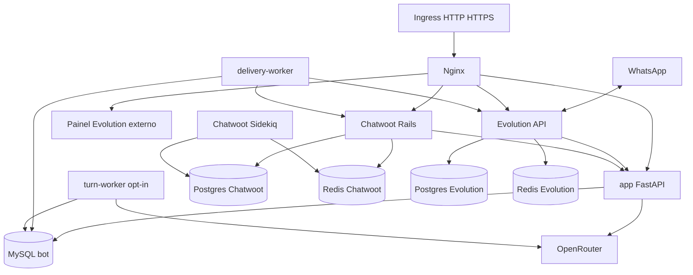

# Arquitetura e fluxos

Base `main` = `dev` = `5908a94`, snapshot documental de 2026-11-09: F0 integrado via PR #14, main promovida por fast-forward, certificação p55 aceita; não equivale a deploy/ativação. [Estado da integração e roadmap](estado-e-roadmap.md).

## Sistemas e fronteiras

Dependências lógicas, não garantia de arestas habilitadas nem inventário de conexões por processo. Adapters, presença e handoff participam de mais de um fluxo.

- MySQL é domínio do bot; Postgres/Redis dos providers não substituem repositórios.
- Rede principal é `<COMPOSE_PROJECT_NAME>_wpp-net`; projeto obrigatório identifica rede/volumes, sem nomes globais de containers. App não publica porta host.
- Só Nginx publica `80/443`, bind default `127.0.0.1`. Borda app permite somente `/`, `/health`, `/webhook` e `/chatwoot/webhook`, com métodos restritos; demais paths retornam 404 sem upstream. Isso não adiciona login ao CRUD interno.
- Integrações internas usam `app:5000`, `evolution:8080`, `chatwoot:3000`, `db:3306`, não `localhost`.
- Callback privado `http://app:5000` exige `SAFE_FETCH_ALLOW_PRIVATE_NETWORK` no Chatwoot; isso amplia confiança global de SafeFetch.

Release executa código da imagem versionada; binds de fonte só no override dev explícito e sinalizados. Allowlist de paths não substitui autenticação de callback nem autoriza abrir ingress em provisioning.

## Entrada Evolution

Fontes: [main.py](../../app/src/main.py), [evolution_orchestrator.py](../../app/src/services/evolution_orchestrator.py), [unit_of_work.py](../../app/src/database/unit_of_work.py).

1. `provisioning` não exige bearer; `enforced` verifica antes de aceitar evento.
2. Parse descarta não acionáveis, `fromMe` e tipos incompatíveis.
3. Resolve agente pela instância e revalida autoridade/estado sob locks.
4. Opt-in seleciona scheduler; sem opt-in, direct/outbox segue runtime DB e Settings.
5. Replay autenticado usa receipt HMAC/identidade, não payload aproximado ou estado mutável da sessão.

## Três caminhos

| Propriedade | Direct não agendado | Outbox não agendado | Scheduler habilitado |
| --- | --- | --- | --- |
| Webhook | Gera e envia | Gera e enfileira | Persiste entrada/membership |
| Durante LLM | UoW/locks abertos | UoW/locks abertos | Provider fora dos locks de finalização |
| Intenção durável pré-LLM | Sem equivalente ao attempt scheduler | Sem equivalente ao attempt scheduler | Attempt commitado antes da chamada |
| Entrega | HTTP imediato | Worker após commit | Admissão e worker outbox |
| Retry | Sem fila durável equivalente | Lease/fence/backoff/TTL | Outbox com autoridade do turn |
| Resposta ao intake | Resultado direto | Queued após commit | HTTP 202 após intake durável |
| Gate | DB/Settings direct | Outbox/epochs/auth enforced | Outbox + scheduler/epochs/frota + opt-in |

Em outbox, ausência de HTTP de entrega no webhook **não** significa ausência de OpenRouter: LLM/resumo legado permanece ali. Fencing não desfaz efeito aceito remotamente nem garante exactly-once.

## Handoff e retorno humano

Fontes: [agent_runner.py](../../app/src/agents/agent_runner.py), [handoff_manager.py](../../app/src/services/handoff_manager.py), [turn_handoff.py](../../app/src/services/turn_handoff.py), [chatwoot_orchestrator.py](../../app/src/services/chatwoot_orchestrator.py).

- `[TRANSFERIR]` decide handoff e é removido do texto visível.
- Sessão encerra com motivo; novos fluxos não passam ao handler legado `humano`.
- Outbox legado: resumo pago na UoW; attempt, abertura e transição bloqueada são persistidos antes do commit.
- Worker abre conversa, grava mapping sob fence e libera transição.
- Scheduler: final-candidate, reply/transição com identidades próprias e contexto tardio em notas privadas determinísticas.
- Atribuição a atendentes é Chatwoot nativo; tabela `atendentes` não roteia novos handoffs.
- Retorno enforced/outbox: assinatura/timestamp → parse → receipt account/mensagem → mapping/attempt/geração válidos → enqueue após transição → commit → worker.
- Compatibilidade direct tem envio imediato próprio; garantia de enqueue não se aplica indistintamente a todos os modos.

## Geração agendada e recovery

Entrada pertence a turn/membership duráveis. Processor grava attempt, chama LLM uma vez e finaliza fenced. Draft/typing/deadline persistem, refresh é limitado e final-candidate não reabre arbitrariamente.

Resultado conhecido pode registrar só accounting após perda de autoridade; desconhecido fica auditável/quarentenado. Não repetir chamada possivelmente paga automaticamente. Worker habilitado sem opt-in não migra todos os agentes.

## Health e shutdown

- `/` é liveness sem DB; `/health` é readiness de corpo público mínimo.
- Diagnósticos em `/internal/health` e `/health/provider-auth`, internos/negados pelo Nginx.
- Monitor produz snapshot provider; health HTTP não faz fanout a cada request.
- Cache de subcoletores não estabelece deadline global; isso ainda é hardening pendente.
- `src.app_server` usa watchdog/drain HTTP 8 s; workers têm budgets/quiescência antes do marcador final.
- Shutdown limitado não torna legado crash-safe: cancelamento pós-LLM ainda pode reverter uso antes do commit.

Locks, guards e tempos exatos → [AGENTS.md §10](../../AGENTS.md#10-princípios-arquiteturais-obrigatórios), sem criar contrato concorrente neste mapa.
