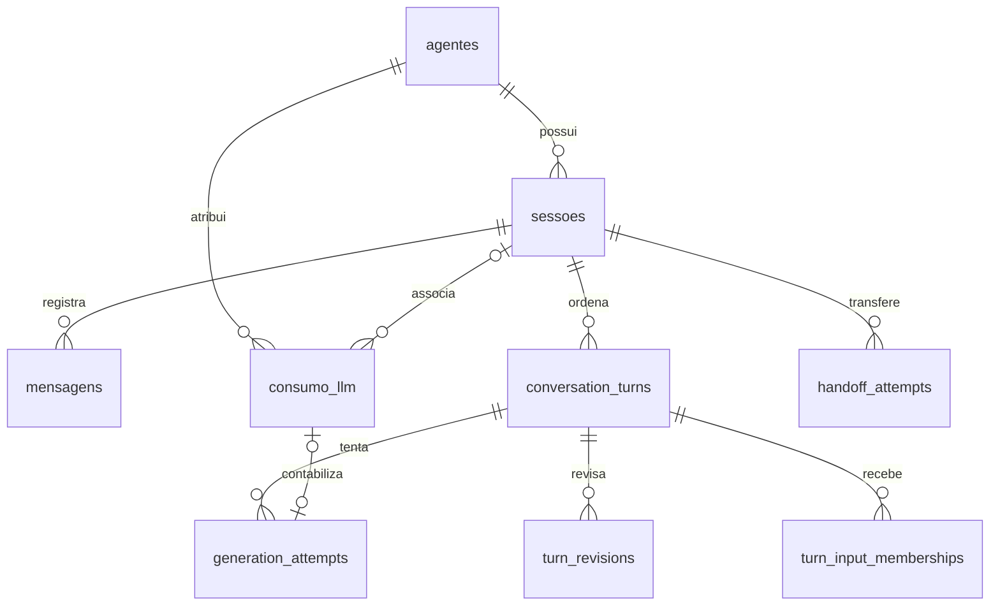

# Mapa de dados e estados

Base `main` = `dev` = `5908a94`, snapshot documental de 2026-11-09: F0 integrado via PR #14, main promovida por fast-forward, certificação p55 aceita; não equivale a deploy/ativação. Fontes exatas: [db/init.sql](../../db/init.sql), [ORM](../../app/src/database/models.py), [repositórios](../../app/src/database/repositories/). São **22 tabelas do bot** no SQL atual, não incluindo bancos internos dos providers.

## Domínio e accounting

| Tabela | Fato persistido |
| --- | --- |
| `agentes` | Instância/número, prompt, modelo permitido, limite, ativo e opt-in scheduler |
| `sessoes` | Agente/telefone, handler, mapping Chatwoot, geração handoff e sequência de entrega |
| `mensagens` | Histórico `user`/`assistant` da sessão |
| `atendentes` | Cadastro legado v3b, não round-robin do handoff Chatwoot |
| `consumo_llm` | Uso conhecido de resposta/resumo, custo, modelo solicitado/reportado e ID provider |
| `llm_usage_reconciliation` | Uso ainda não consolidado, erro seguro, processamento e vínculo de resolução |

`modelo_openai`/`numero_notificacao` ainda existem por compatibilidade; não significam provider direto OpenAI nem notificação WhatsApp no handoff novo. `modelo_llm` é preferido pelo runtime. Preços comerciais e usuários/empresas não têm entidades de billing/tenancy no schema atual.

## Intake, entrega e controle

| Tabela | Fato persistido |
| --- | --- |
| `inbound_events` | Identidade provider/escopo/evento, HMAC versionado, disposition e vínculo com mensagem |
| `handoff_attempts` | Geração/attempt do handoff, estado e mapping remoto |
| `outbox_deliveries` | Operação versionada, stream/ordem, dependência, lease/fence, tentativas e resultado |
| `delivery_runtime_state` | Autoridade singleton `direct`/`outbox`/`frozen`, epoch e versão |
| `delivery_worker_heartbeats` | Frota delivery, modo/epoch, readiness e vitalidade |
| `delivery_operator_actions` | Auditoria de ações operacionais |
| `replica_heartbeats` | Fingerprint por processo de app/delivery/turn, schema/code/mode/epochs/flags |

Receipt não armazena payload bruto como fonte de decisão. `receipt_disposition` é verdade histórica imutável; não inferir replay a partir do handler atual.

## Scheduler e contexto tardio

| Tabela | Fato persistido |
| --- | --- |
| `scheduler_runtime_state` | Estado/epoch/versão/schema e caps do scheduler |
| `agent_service_lanes` | Dono/lease/fence da faixa de atendimento por agente |
| `conversation_turns` | Turn ordenado e slot active/successor/terminal |
| `turn_revisions` | Entrada selada, draft, refresh, typing e revisão final |
| `turn_input_memberships` | Cada entrada recebida vinculada ao turn e eventual revisão selada |
| `generation_attempts` | Tentativa de resposta/resumo, outcome/accounting e vínculo exato de consumo |
| `scheduled_handoffs` | Handoff final associado ao turn/revisão/attempt de resumo |
| `handoff_context_assignments` | Transferência única de input sucessor para contexto do handoff |
| `scheduler_retention_progress` | Checkpoints de varredura/retenção, sem FK/trigger |

Tabelas presentes não autorizam intake/dispatch. Schema esperado é `3`, validado pelo código; flags e autoridade DB são gates separados.

## Autenticação da API

| Tabela | Fato persistido |
| --- | --- |
| `auth_usuarios` | E-mail canônico único, papel fixo, status, hash argon2id+pepper, TOTP cifrado e contadores de bloqueio |
| `auth_sessoes` | Hash da sessão opaca/desafio TOTP, estágio, hash CSRF, validade e revogação |
| `auth_tokens_servico` | Hash do token Bearer, papel não-admin, expiração e revogação |
| `auth_tokens_uso_unico` | Hash de ativação/reset entregue fora do sistema, validade e uso único |
| `auth_auditoria` | Eventos allowlisted de login, MFA, negação, CLI e mutações de agente/sessão, com dados mascarados |

Folhas aditivas, sem FK para o domínio; usuários nunca são apagados. Não alteram `schema_version` do scheduler. Sem `empresa_id`: escopo por empresa é coluna futura aditiva.

## Relações centrais

Visão parcial de cardinalidades lógicas. Nullability, FKs compostas de autoridade, `RESTRICT`, índices e checks exatos estão no SQL/ORM; não gerar migration deste diagrama.

## Estados: não são a mesma máquina

| Entidade | Estados/slots declarados |
| --- | --- |
| Sessão | `bot`, `humano`, `encerrada` (`humano` legado) |
| Delivery runtime | `direct`, `outbox`, `frozen` |
| Scheduler runtime | `disabled`, `enabling`, `enabled`, `draining` |
| Turn | `pending`, `claimed`, `generating`, `typing`, `awaiting_delivery`, `retry`, `delivered`, `handoff`, `cancelled`, `dead` |
| Turn slot | `active`, `successor`, `terminal` |
| Revisão | `collecting`, `generating`, `draft`, `typing`, `final_candidate`, `admitted`, `superseded`, `cancelled`, `dead` |
| Generation outcome | `started`, `succeeded`, `failed`, `outcome_unknown` |
| Generation accounting | `pending`, `recorded`, `reconciliation_required` |
| Handoff attempt | `pending`, `ready`, `failed`, `superseded`, `cancelled` |
| Outbox | `blocked`, `pending`, `processing`, `retry`, `delivered`, `dead`, `cancelled` |
| Reconciliação | `pending`, `processing`, `resolved`, `dead` |

Enum não é licença para transitar entre quaisquer estados: guards/allowlists e invariantes em AGENTS §10 restringem cada transição. `typing` é espera local persistida; presença remota é best-effort.

## Identidade e integridade

- Sessão única por `(agente_id, telefone)`; telefone não identifica sessão global entre agentes.
- Delivery stream/sequence preserva ordem, inclusive reserva da transição handoff.
- Receipt único por provider/escopo/ID; mesmo ID com conteúdo conflitante não é mensagem nova.
- `provider_generation_id` único em consumo; vínculo attempt/ledger exige identidade exata, não wildcard quando ID é nulo.
- `modelo_llm` é solicitado; `modelo_llm_reportado` guarda eco literal do provider, sem normalização comercial aproximada.
- Quantias usam `Decimal`/DECIMAL; ausência/ambiguidade não deve ser inventada como consumo zero.
- Lease, token, epochs e authority links impedem finalização por dono antigo, mas não desfazem efeitos remotos.

## Migration, delete e retenção

- `db-migrate` aplica `init.sql` antes do app; start pode executar DDL em banco já existente.
- Shape exato, checks/digests e guards versionados são contrato: não corrigir divergência removendo/recriando objetos manualmente.
- FKs do schema não substituem lifecycle: API recusa delete de agente com evidência em `consumo_llm`, `llm_usage_reconciliation` ou `handoff_attempts`.
- Sessões/handoffs/turns possuem barreiras de histórico e terminalidade; não usar SQL direto para ultrapassá-las.
- Retenção trata dados operacionais/terminais em lotes com progresso, budgets e sinais. Não é comando genérico para apagar conversas ou ledger comercial.
- Antes de nova FK, auditar todo delete/purge dependente. Mudança de DDL requer prova sobre banco novo, populado/copied e reaplicação idempotente.

Limitação conhecida: geração não agendada grava uso na mesma UoW do webhook; rollback pós-provider pode apagar ledger/reconciliação. Scheduler tem attempt durável anterior, não uma garantia mágica de reconstrução exata de resposta remota desconhecida.
